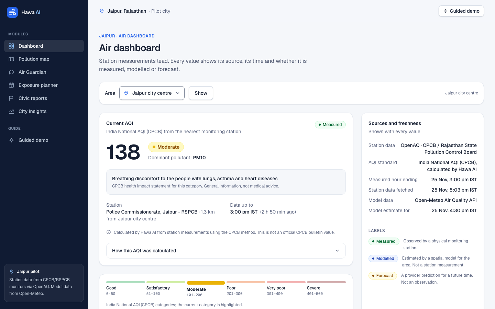
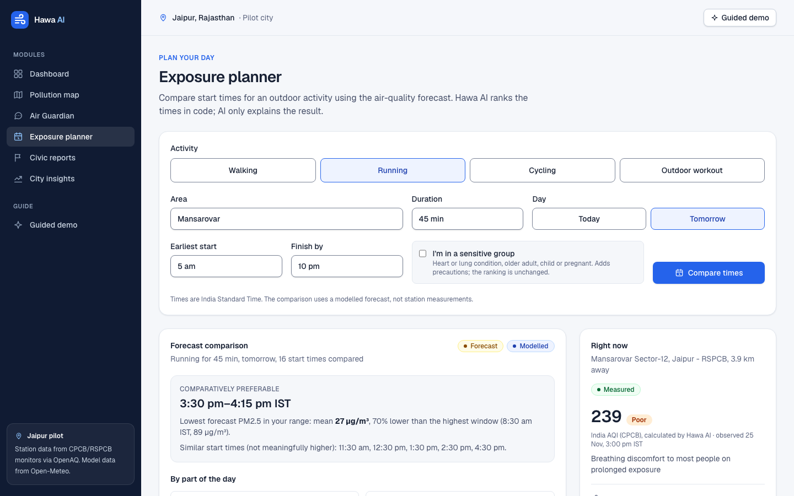
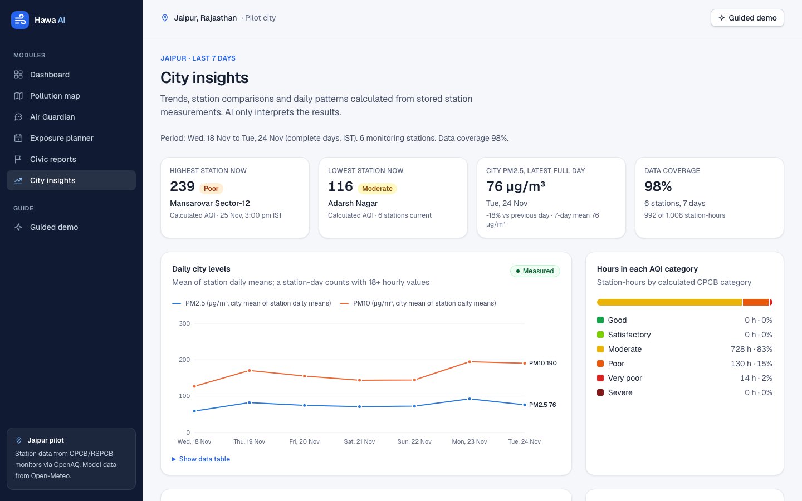
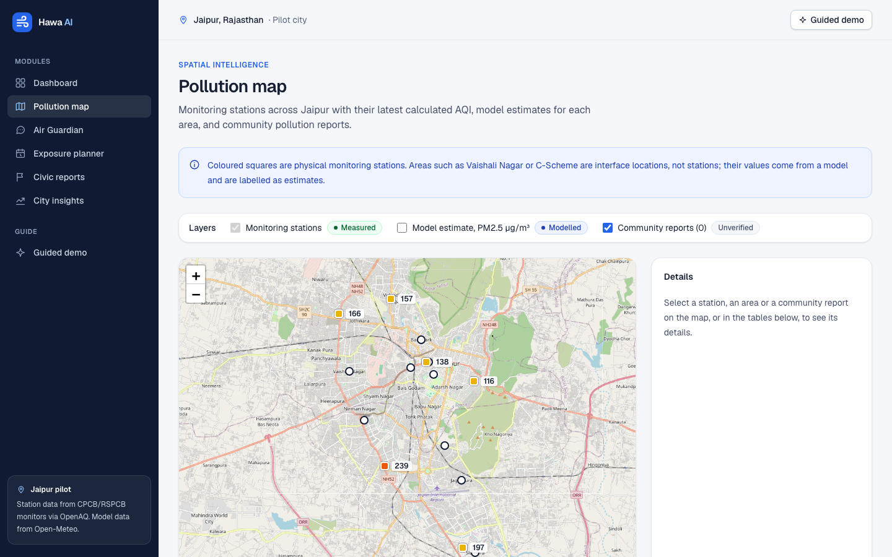

# Hawa AI

**Understand the air. Predict exposure. Take action.** Evidence-grounded AI for city air quality, piloting in **Jaipur, Rajasthan**.

**Live app:** https://hawa-ai.vercel.app · **Guided demo:** https://hawa-ai.vercel.app/demo



## What it does

| Question | Module | How |
| --- | --- | --- |
| What's happening? | **Dashboard** and **AI daily brief** | Live AQI from Jaipur's CPCB/RSPCB stations (via OpenAQ), calculated with India's CPCB method and labelled as such; every value shows source and time |
| Why is it happening? | **Air Guardian** | Gemini function calling over allowlisted data tools; evidence and tool activity built by the server; English and Hindi |
| What's likely to happen? | **City insights** and forecasts | 7-day trends, station comparison and daily rhythm calculated in code; forecasts labelled as modelled |
| What should I do? | **Health advisor** and **Exposure planner** | India's official AQI health advice (MoHFW/CPCB, WHO caveats) applied by a rules engine to your group and activity; the planner ranks outdoor times from the forecast; Gemini explains both, never diagnoses, prescribes or calls anything "safe" |
| How can I help? | **AI photo reporter** and **pollution map** | Gemini vision classifies a citizen photo (category, confidence, limitations); reports appear on the map; photos stay private |

**AI never invents a number:** every AQI or concentration in an AI answer must match the data it retrieved (the grounding check), or the answer is corrected or replaced by an honest fallback.

| | | |
| --- | --- | --- |
|  |  |  |

> **Status: Day 6 (feature-complete for the hackathon).** Real Jaipur air-quality data (OpenAQ stations, Open-Meteo model) with a Hawa AI-calculated CPCB AQI; dashboard, interactive pollution map, **Air Guardian** (Gemini tool calling, grounded answers with evidence, English and Hindi), an **AI Daily Air Brief**, the **Exposure planner** (deterministic forecast ranking with an optional grounded AI explanation), the **AI civic pollution reporter** (anonymous photo reports analysed by Gemini vision, shown on the map) **City insights** (7-day trends, station comparison and daily rhythm calculated in code, with an optional AI interpretation) and the **Health advisor** (official MoHFW/CPCB guidance by group and activity). A **guided demo** (`/demo`) walks through everything on live data with readiness checks. No sign-in yet; Settings is a placeholder and is not in the navigation.

## Stack

Next.js 16 (App Router) · React 19 · TypeScript (strict) · Tailwind CSS 4 · Zod · Vitest · Playwright · pgTAP. Data: Supabase (Postgres 17, PostGIS, Row Level Security, Storage), OpenAQ v3, Open-Meteo Air Quality. AI: Google Gemini (`@google/genai`, server-side only). Maps: Leaflet + OpenStreetMap. Deployment: Vercel (Mumbai region); hourly ingestion scheduled inside Supabase (`pg_cron` + `pg_net`).

## Getting started

Requirements: Node.js ≥ 20.9 (developed on Node 24) and npm.

```bash
npm install
cp .env.example .env.local      # Supabase keys for data; GEMINI_API_KEY for AI; OPENAQ_API_KEY and CRON_SECRET for ingestion
npm run dev                     # http://localhost:3000
```

For end-to-end tests, install the Playwright browser once:

```bash
npx playwright install chromium
```

## Scripts

| Script | Purpose |
| --- | --- |
| `npm run dev` | Start the development server |
| `npm run build` / `npm start` | Create and serve a production build |
| `npm run typecheck` | Generate route types and run `tsc --noEmit` |
| `npm run lint` | Run ESLint (Next.js core-web-vitals and TypeScript rules) |
| `npm test` | Run unit tests (Vitest) |
| `npm run test:live` | Live checks against OpenAQ and Open-Meteo for Jaipur (uses `.env.local`) |
| `npm run test:e2e` | Run E2E tests on desktop, tablet and mobile viewports (Playwright, production build on port 3100) |
| `npm run check` | Typecheck, lint and unit tests |
| `npm run db:rehearse` | Dry-run all migrations, seed and DB tests in one transaction, then roll back |
| `npm run db:push` | Apply migrations and seed to Supabase (`SUPABASE_DB_URL` in `.env.local`) |
| `npm run db:test` | Run pgTAP security tests (rolled back; leaves no data) |
| `npm run db:types` | Regenerate Supabase TypeScript types |
| `npm run db:schedule -- https://<app>` | Store the app URL and `CRON_SECRET` in Supabase Vault for the hourly jobs |
| `npm run db:schedule-status` | Show the hourly jobs, recent runs and HTTP results |
| `npm run db:schedule-run -- ingest` | Run ingestion (or `brief`) now, e.g. before a demo |

## Routes

| Route | Module | State |
| --- | --- | --- |
| `/` | Landing page | Built |
| `/dashboard?location=<slug>` | Air dashboard | Built on stored provider data |
| `/map` | Pollution map (stations, areas, model layer; OpenStreetMap) | Built |
| `/guardian` | Air Guardian (AI, grounded, English and Hindi) | Built; needs `GEMINI_API_KEY` |
| `/planner` | Exposure planner (forecast ranking in code; AI explanation in English or Hindi) | Built; AI part needs `GEMINI_API_KEY` |
| `/reports`, `/reports/new` | Civic reports: anonymous photo reports with AI analysis | Built; needs `GEMINI_API_KEY` and `SUPABASE_SERVICE_ROLE_KEY` |
| `/insights` | City insights: 7-day trends, station comparison, daily rhythm, AI interpretation | Built; AI part needs `GEMINI_API_KEY` |
| `/advisor?location&profile&activity` | Health advisor: official guidance for your group and activity, AI explanation (EN/HI) | Built |
| `/demo` | Guided demo: live readiness checks (no provider or AI calls) and the 3-minute script with deep links | Built |
| `/settings` | Settings | Placeholder |
| `/api/health` | Liveness check | Built |
| `/api/air-quality?location=<slug>` | Latest measured and modelled data for an area | Built |
| `/api/forecast?location=<slug>&hours=<n>` | Hourly modelled forecast | Built |
| `/api/cron/ingest` | Provider ingestion (Bearer `CRON_SECRET`) | Built; not scheduled yet |
| `/api/ai/chat` | Air Guardian API (rate-limited) | Built |
| `/api/planner/explain` | AI explanation of an exposure plan (rate-limited) | Built |
| `/api/cron/brief` | Daily Air Brief generation (Bearer `CRON_SECRET`) | Built; run by the hourly workflow |
| `/api/reports` | `GET` published reports (public columns); `POST` submit an analysed report (rate-limited) | Built |
| `/api/reports/analyze` | AI photo analysis; nothing stored (rate-limited) | Built |
| `/api/insights/explain` | AI interpretation of City insights (rate-limited) | Built |
| `/api/advisor/explain` | AI explanation of a health advisory, with medical-safety checks (rate-limited) | Built |

## Project structure

```text
src/
  app/            routes: (marketing) landing, (app) product shell, api/
  components/     ui/ primitives · layout/ shell and navigation · feature-area folders
  features/       feature-owned logic (air-quality, ai-guardian, exposure-planner, civic-reports, city-insights)
  lib/            infrastructure clients and helpers (supabase, gemini, maps, http, utils, …)
  services/       provider adapters, normalisation, caching, location
  config/         site config, navigation, validated environment
supabase/         migrations, seed data and pgTAP database tests (see docs/database.md)
tests/            unit/ · integration/ · e2e/
docs/             architecture and development log
```

See [docs/architecture.md](docs/architecture.md), [docs/database.md](docs/database.md), [docs/air-quality-data.md](docs/air-quality-data.md), [docs/ai-guardian.md](docs/ai-guardian.md), [docs/exposure-planner.md](docs/exposure-planner.md), [docs/civic-reports.md](docs/civic-reports.md), [docs/city-insights.md](docs/city-insights.md) and [docs/health-advisor.md](docs/health-advisor.md) for the design and [AGENTS.md](AGENTS.md) for the engineering rules all contributors and AI agents follow.

## Environment variables

See [.env.example](.env.example). Only `NEXT_PUBLIC_*` values reach the browser. Server secrets are read through `getServerEnv()` in `src/config/env.ts`, which cannot be imported into client code.

## Deployment (Vercel)

1. Import the GitHub repository in Vercel.
2. Add the environment variables from `.env.example` for each environment. Set `NEXT_PUBLIC_APP_URL` to the deployment URL.
3. Use `/api/health` for uptime monitoring.

## Disclaimer

Hawa AI provides general air-quality information and is not medical advice. Community reports are not official complaints to any authority.
